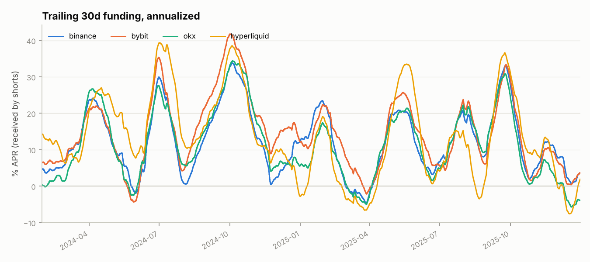
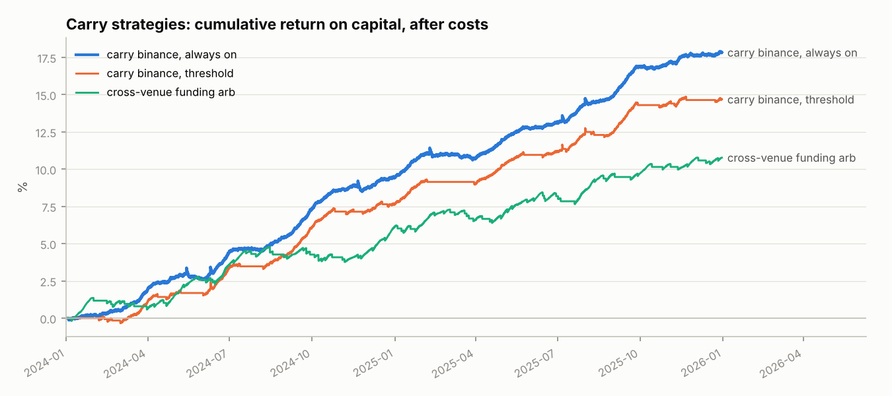
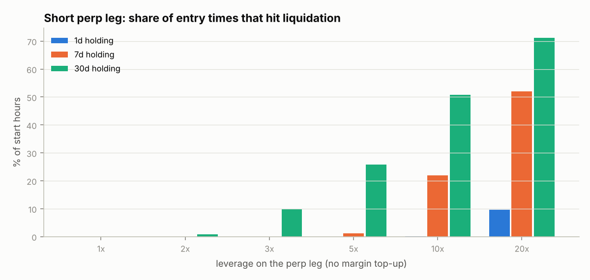

# Funding & basis carry across crypto venues

How much does the "delta-neutral" funding trade really earn after costs, how
does it depend on market regime, and what can blow it up?

This project collects perpetual funding rates from **Binance, Bybit, OKX and
Hyperliquid** plus Binance spot and perp prices, then studies three trades:

1. **Cash-and-carry, always on**: long spot, short perp, held permanently (passive baseline)
2. **Cash-and-carry with entry/exit thresholds** on trailing funding (hysteresis)
3. **Cross-venue funding arbitrage**: short the perp where funding is highest, long it where it is lowest

…with explicit fees, slippage, capital usage, and a **liquidation-risk study**
of the short perp leg.

> Status: framework complete and tested; figures below come from the synthetic
> demo panel, so their levels mean nothing. Results on real data go in
> [`notes/research_note.md`](notes/research_note.md).

## Method

**Data.** Funding settlements are kept at their real timestamps (8h on the
CEXs for BTC and ETH, 1h on Hyperliquid) on an hourly UTC grid. Prices are
hourly closes, labelled at the instant they are observed.

**No look-ahead.** A position decided at hour *t* uses only funding paid up
to *t*, and earns the funding paid at *t+1* plus the premium change from *t*
to *t+1*. The venue for the single-venue trade is fixed in advance (default
Binance), not chosen as the venue with the best funding over the sample.

**PnL per hour** (notional *N*, position ∈ {0, 1}):

| Component | Cash-and-carry | Cross-venue |
|---|---|---|
| Funding | `pos · N · f_t` (shorts receive positive funding) | `N · (f_short − f_long)` |
| Basis | `−pos · N · Δpremium` | assumed 0 (perp vs perp) |
| Costs | taker fees on both legs + slippage, per trade | perp fee + slippage per leg change |
| Capital | `N + N / leverage` | `2N / leverage` |

Returns are reported **on capital**, not on notional. Funding APR on notional
overstates what the trade earns on the money it ties up.

**Regimes.** Time is bucketed by cross-venue 30d funding (negative / low /
normal / high / extreme). For each bucket we report spot returns and the
*next* 30 days' funding, to test whether high funding persists or mean-reverts.

**Liquidation risk.** For leverage *L* on the perp leg, the short is
liquidated after a rally of roughly `(1/L − m)/(1 + m)`. We measure how often
historical rallies within 1, 7 and 30 days would have reached that level if
margin were never topped up.

## Demo output (synthetic data)





Even on synthetic data the cost structure shows up clearly. The threshold
strategy pays about **$56k in costs over 17 round trips** to avoid
negative-funding periods, and ends up below the always-on baseline.
Cross-venue arbitrage spends **$104k of its $176k gross funding** on leg
switches. The real-data question is whether venue dispersion is large and
persistent enough to pay for that.



## Quickstart

```bash
pip install -e ".[dev]"
pytest                                    # 8 tests: timing, no look-ahead, PnL signs, API parsing

# offline demo
python -m carry.cli report --synthetic --out reports/demo

# real data
python -m carry.cli fetch --coins BTC ETH --days 3          # smoke test first: check the printed ranges
python -m carry.cli fetch --coins BTC ETH --start 2024-01-01
python -m carry.cli report --coin BTC --out reports/BTC
python -m carry.cli report --coin BTC --entry-apr 0.15 --exit-apr 0.05 --leverage 2 --out reports/BTC_conservative
```

`report` writes `summary.json`, CSV tables (`venues`, `apr_by_year`,
`regimes`, `liquidation`, one hourly backtest file per strategy) and PNG
figures.

### About the data

- The fetchers use each venue's **public** REST API, so no keys are needed.
  History depth varies: OKX's public endpoint only goes back a few months.
  For longer OKX history, use their historical data downloads.
- Binance spot and perp hourly closes are used as the price reference for every venue.

## Limitations (state these in interviews before you're asked)

- Basis PnL uses Binance's perp premium for all venues.
- Cross-venue arb ignores perp-vs-perp price divergence between venues, which widens in stress.
- No margin interest, no transfer or withdrawal costs and delays, and no exchange default risk. After FTX, that last one is not academic.
- Hourly resolution: intra-hour liquidation wicks are underestimated.
- Constant taker fees: real fees depend on volume tier, and you can enter as a maker to save cost at the price of execution risk.

## Next steps

- [ ] Run on BTC and ETH since 2024 on all four venues, then fill in the research note
- [ ] Venue-specific perp prices for basis PnL
- [ ] Dated futures basis (Binance or Deribit quarterlies) vs perp funding: which is the cheaper carry?
- [ ] Predicted vs realized funding: does the published next funding rate improve timing?
- [ ] Capital efficiency with portfolio or cross margin (spot as collateral)

## References

- He, Manela, Ross & von Wachter (2022), *Fundamentals of Perpetual Futures*.
- Exchange API documentation: Binance USDⓈ-M Futures, Bybit v5, OKX v5, Hyperliquid info endpoint.
